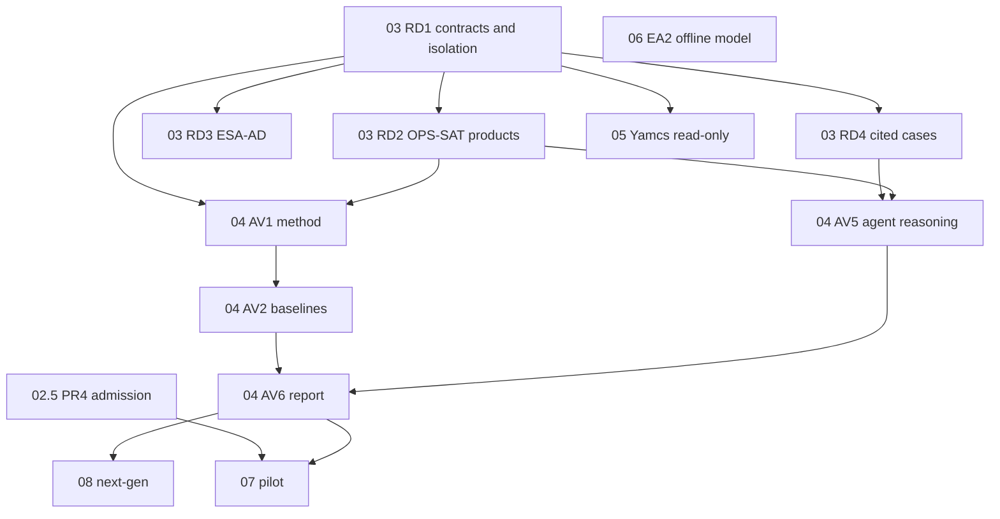

# Master roadmap

**Date:** 2026-11-24
**Status:** Planning only. This change adds no runtime behavior.
**Current admission decision:** No-go - remain reference/stage only. Unchanged.

The project has a working lab: a single LangGraph agent, MCP tools, RAG, OPA, approvals,
NATS, Postgres, replay, evals, Helm, GitOps, and a GCP stage path. The next work proves
what that lab does on cited mission data and on a fixed benchmark. It does not add another
autonomy architecture first.

## Sequence

| Phase | Name | State | Role |
|-------|------|-------|------|
| 01 | Foundation and MVP | Done | Lab agent, MCP, RAG, OPA, HITL. |
| 02 | Production Scale | Done | Streaming, Kubernetes, GitOps, GCP, LLM gateway. |
| 02.5 | Production Readiness | PR4 remaining | Security, reliability, and the only admission decision. |
| 03 | Real-World Mission Data | Planned | Isolated replay and analysis from at least two distinct missions, plus historical incident cases. |
| 04 | Anomaly Detection and Scientific Validation | Planned | Detectors and agent scores, kept separate. |
| 05 | Mission Control Integration | Planned | Read-only Yamcs and a public stream. |
| 06 | Edge AI and Hardware Research | Research | Jetson measurements and the offline model. Not flight readiness. |
| 07 | External Validation and Productisation | Planned | Paper, review, and a pilot that stays behind admission. |
| 08 | Next-Gen Autonomy | Deferred | Preserved L3/L4 specs. Not the next build. |

## What already exists

- Agent loop in `apps/agent/graph.py`: triage, investigate, escalation check, decide, act, report.
- Contracts in `apps/contracts/v1.py`. `TelemetryEventV1` has no mission or license field. `metadata` is the compatible place for provenance.
- Ingest in `apps/api/main.py`. Approval OIDC protects approval routes. Ingest does not use that dependency.
- Synthetic fixture `data/telemetry/telemetry.ndjson`. This remains the CI dataset.
- NATS JetStream ingest (ADR 0002), Postgres `telemetry_events`, telemetry and KB MCP, ticketing and GitOps MCP, OPA, approval store, replay runbook, and `evals/`.
- Helm, Terraform, compose, engineering-book workflow, and the 2026-11-23 No-go review.
- Next-gen specifications under `roadmap/deprecated-03-next-gen-autonomy/`. All of those boards are Todo. No next-gen code is on the branch.

## What this roadmap does not pretend exists

There is no mission registry, no OPS-SAT or ESA-AD import, no detector interface, no Yamcs
client, no SatNOGS client, no ONNX or TensorRT path, no Jetson runbook, and no benchmark paper.
Dependabot and the Docker build are not an SBOM or a signed image.

## Corrections to the proposed plan

- OPSSAT-AD is Zenodo [10.5281/zenodo.12588359](https://doi.org/10.5281/zenodo.12588359), CC BY 4.0. The released `dataset.csv` contains 2123 segments with 1594 train and 529 test rows, counted from the `train` flag. The paper prints 1494 in the training total, while its class counts (1273 nominal plus 321 anomalous) sum to 1594. The split is stratified random. Channels are three magnetometers and six photodiodes. [Benchmark paper, Table 1](https://arxiv.org/html/2407.04730v1#S2.T1)
- The May 2024 OPS-SAT UHF re-entry campaign is a different product. Its analysis page describes physical columns, including battery voltage and temperatures. This pass did not find a machine-readable license, so import stays blocked until one is recorded. Its rows do not inherit OPSSAT-AD labels.
- ESA-AD is Zenodo [10.5281/zenodo.12528696](https://doi.org/10.5281/zenodo.12528696), CC BY 3.0 IGO. The benchmark code at `kplabs-pl/ESA-ADB` is MIT. The dataset has three anonymized missions. The published benchmark uses two. Rare nominal events are not anomalies, even though the upstream runner currently treats them as anomalies. Telecommands are not labels. Mission3 has none in the published table.
- SMAP/MSL is an optional holdout after a license check. It is not a phase exit.
- Yamcs server is AGPL-3.0. Its API and clients are LGPL. The connector is local and read-only. Command APIs are not wrapped.
- The engineering-book workflow already exists and PR3.5 is Done. PR4.11 verifies the current run. It does not assume a failure.
- Phase 08 was already the title of `roadmap/deprecated-03-next-gen-autonomy.md`. The execution folder stays as the historical spec. New disposition files live in `roadmap/08-next-gen-autonomy/`.

## Public historical data and benchmark integrity

- Follow the [model egress policy](03-real-world-mission-data/LLM_DATA_POLICY.md): external processing is denied by default, with a narrow reviewed approval path for versioned public historical fields in isolated local/dev experiments. Local-only model execution is the fallback; a non-LLM replay is not an agent benchmark. No stage or pilot admission changes.
- Historical cases may be memorized by pretrained LLMs. AV5 distinguishes public-report reconstruction from evidence-grounded generalization using blinded cases, identity-only and no-evidence controls, and separate reporting of synthetic or perturbed cases. No public case score proves unseen-event performance.

## Four different readiness words

| Word | Meaning | Where it is decided |
|------|---------|---------------------|
| Production readiness | A limited pilot may start. | PR4.7 only. Today: No-go. |
| Domain validation | A cited dataset and a frozen metric were measured. | Phases 03 and 04. |
| External pilot readiness | Someone outside the repo uses a bounded, admitted deployment. | EV4, and only after PR4.7 changes the decision. |
| Flight readiness | Hardware and software qualified for a spacecraft. | Not a goal. EA4 exists to prevent this confusion. |

## Priorities

| Priority | Work | What it does not unlock |
|----------|------|-------------------------|
| P0 | Finish PR4, including PR4.8-PR4.12 as evidence or waivers. Start RD1 and RD2. | RD2 does not change No-go. PR4 does not require a detector. |
| P1 | RD3, RD4, and AV1-AV6. | A good detector score is not admission and not a root-cause claim. |
| P2 | MC1-MC4. | A Yamcs tab is not command authority. |
| P3 | EA1-EA4. | A lab board is not a flight computer. |
| Parallel | EV conversations and method notes. Results, public claims, and any pilot wait for their gates. | Networking is not a partnership and not a data-sharing agreement. |

## Dependency graph

## Critical path

The admission path is PR4.1 through PR4.7, plus a disposition of PR4.8 through PR4.12.
Close-out of the existing drills still waits for the network hold recorded in the PR4 sprint
review. The evidence path is RD1, then the labeled OPSSAT-AD release,
then AV1 and the baselines. The independent agent path is RD4.3 plus RD2.3, then AV5; it can start before AV2-AV4 finish. AV6 joins the two paths. Mission-control and edge work can slip without blocking
that report. Next-gen work waits on the AV6.2 paragraph.

## Optional research

Thor, EuroHPC, SMAP/MSL, GraphRAG, and multi-agent specialists are optional. Each has a
written entry condition in its phase. None is required to keep the lab useful.

## How a phase stops

Every phase README has an exit gate. Missing a gate stops the next claim. It does not delete
the lab, and it does not mark a speculative task Done. A negative benchmark result is a
completed study, not a failed project.

## Execution index

| Phase | Strategy | Board root |
|-------|----------|------------|
| 02.5 | [02.5-production-readiness.md](02.5-production-readiness.md) | [sprint 4](02.5-production-readiness/sprint-4/BOARD.md) |
| 03 | [03-real-world-mission-data.md](03-real-world-mission-data.md) | [phase](03-real-world-mission-data/README.md) |
| 04 | [04-anomaly-detection-validation.md](04-anomaly-detection-validation.md) | [phase](04-anomaly-detection-validation/README.md) |
| 05 | [05-mission-control-integration.md](05-mission-control-integration.md) | [phase](05-mission-control-integration/README.md) |
| 06 | [06-edge-ai-hardware.md](06-edge-ai-hardware.md) | [phase](06-edge-ai-hardware/README.md) |
| 07 | [07-external-validation.md](07-external-validation.md) | [phase](07-external-validation/README.md) |
| 08 | [08-next-gen-autonomy.md](08-next-gen-autonomy.md) | [phase](08-next-gen-autonomy/README.md) |

Historical next-gen specifications: [deprecated-03-next-gen-autonomy/](deprecated-03-next-gen-autonomy/).
